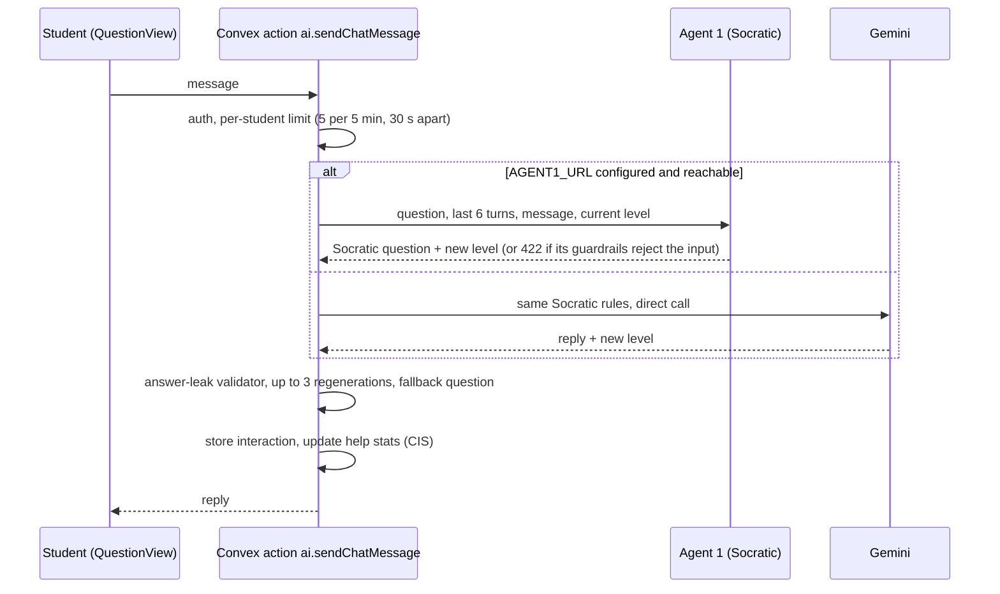

# CogAIt: Think First, AI Next

> An AI tutor for JEE/NEET students that is built **not** to give answers. It asks questions, escalates help one level at a time, checks every reply for leaked answers, and measures how independently each student is thinking.

[](https://github.com/mohanreddythippireddy14-cell/CogAIt/actions/workflows/ci.yml)
[](LICENSE)

**Status: working prototype.** It runs end to end for students and lecturers, but it has not been piloted with an institution yet. What is planned or incomplete is listed in [FUTURE_ACTIONS.md](FUTURE_ACTIONS.md).

---

## The idea

When students use AI for instant answers, they skip the struggle that builds understanding. Most AI study tools optimise for getting the student to the answer. CogAIt optimises for **keeping the student thinking**:

1. **The AI never closes the loop.** Every reply is a question or a small nudge, never the final value, a worked solution or "yes, that's correct".
2. **Help escalates gradually.** There are four levels: 1 *Audit* (one open question), 2 *Socratic* (expose a gap), 3 *Instruction* (name a concept, as a question) and 4 *Deep assistance* (one concrete next step). The tutor is told to step up one level when the student is stuck and back down when they are following (the code keeps the level within 1–4).
3. **Replies are checked, not trusted.** A validator rejects replies that contain a final numerical answer, a step-by-step solution or a direct confirmation, regenerates them up to 3 times, and otherwise serves a fixed fallback question.
4. **Independence is measured.** Each answer gets a Cognitive Independence Score (CIS) based on how much help, and how deep, the student needed. Lecturers see who depends on AI, per topic.

## How a help request works



## Guardrails: what is enforced today

| Guardrail | Status | Where |
|---|---|---|
| Socratic rules in the prompt (no answers, ≤2 questions, end with a question) | Enforced | `convex/ai.ts`, `agents/src/agent1_socratic` |
| Answer-leak validator, regeneration and fallback | Enforced on every reply | `convex/domain/aiPolicy.ts` |
| Help limit: 5 requests per 5 minutes and a 30 s pause, per student | Enforced | `convex/application/aiService.ts` |
| Agent 1 input checks: at least 15 characters, "just give me the answer" patterns, PII, prompt injection (LLM check) | Enforced when the tutor goes through Agent 1 | `agents/src/hooks/pre_hooks.ts` |
| **Think-first gate** (minimum written reasoning before help) | **Not enforced yet.** Each assignment stores `minReasoningChars` (default 30), but nothing checks it | see FUTURE_ACTIONS A1 |
| Exam integrity: tab-switch and copy/paste logging, auto-submit after 5 violations | Enforced | `QuestionView.tsx`, `convex/sessionLocks.ts` |
| Organisation daily AI limit, token cost governance | Implemented behind feature flags, **off by default** | `convex/rateLimits.ts`, `convex/costGovernance.ts` |
| Judge (Agent 8): leak check + rubric on agent outputs | After the fact; records verdicts, does not block | `agents/src/agent8_judge` |

## The agent layer

Besides the tutor, eight small Node/Hono services handle analysis after the student submits. They talk to each other with authenticated HTTP events (`agents/src/pubsub`), which stand in for Cloud Pub/Sub.

| Agent | What it does | Triggered by | Data | Status |
|---|---|---|---|---|
| 1 Socratic | Writes the tutor's reply | Convex `sendChatMessage` (when `AGENT1_URL` is set) | Question context and conversation | Working; optional (direct-Gemini fallback) |
| 2 Analyst | Turns a submitted session into topic signals and a chat summary | Browser, on answer submit | Session log from Convex | Working |
| Negotiation | Offers remediation in chat or through the consent panel | Agent 2 | Weak topics stored on the conversation | Working |
| 3 Content | Builds a two-phase practice set | Negotiation (student said yes) | Model knowledge only, **no verified sources yet**; always flagged for review | Working, ungrounded |
| 4 Long-term | Student report: CIS per week/month/quarter/year, topic trends, risk flags | Agent 2 | Real attempt history from Convex | Working |
| 5 Ingestion | Extracted document text → draft assignment for the lecturer | API call (`document_uploaded`); the UI uses the Convex generator instead | Text you provide (no Document AI yet) | Working |
| 6 Cohort | Failing topics, at-risk and AI-dependent students per assignment | Agent 4, once 5 students have reports | Agent 4 reports | Working (deterministic) |
| 7 Recommendation | Lecturer briefing | Agent 6, or the lecturer dashboard | Cohort data | Working |
| 8 Judge | Audits outputs of agents 1, 3, 7 | Agent events | Agent outputs | Working (records only) |

Limitations, all listed in FUTURE_ACTIONS:
- Agents keep their own records (briefings, verdicts, cohort buffers) as JSON files in `agents/.memory/`, which do not persist on Cloud Run.
- Convex in the cloud cannot reach agents on `localhost`, so locally the tutor uses the direct-Gemini path unless Agent 1 is publicly reachable.

## Scores

The formulas live in `convex/domain/scoring.ts` and are unit-tested:
- **CIS_v1 (per question):** `100 − 15 × highest help level − 5 × help requests + 10 if >50 chars of reasoning before the first help`, clamped to 0–100. The assignment CIS is the mean over submitted questions. Spec: [docs/CIS_SPEC.md](docs/CIS_SPEC.md).
- **Independence score (per assignment):** `0.5 × correctness + 0.35 × (100 − 12 per help request, max −60) + 0.15 × time`.
- **Cognitive score (per question):** `0.4 × correct + 0.3 × independence + 0.2 × time efficiency + 0.1 × thinking time before first help`, × 1.0 / 1.1 / 1.2 for easy / medium / hard.

## Tech stack

- **Frontend:** React 19, Vite 6, Tailwind CSS 3.4, MathJax (from CDN) for LaTeX
- **Backend:** Convex (database, functions, crons) and Convex Auth (email + password)
- **AI:** Google Gemini, default `gemini-3.5-flash` (override with `GEMINI_MODEL`). Convex calls it with `@google/generative-ai`. The agents call Gemini's OpenAI-compatible endpoint through the Convex route `/api/gemini-proxy/...`, using the Groq SDK purely as an HTTP client. No Groq models are used.
- **Agents:** Node 22, Hono, TypeScript. Dockerfiles and Cloud Build configs for Cloud Run are in `agents/docker` and `agents/deploy` (not deployed or verified).

## Getting started

Prerequisites: Node.js 22.12+, a free [Convex](https://convex.dev) account and a [Gemini API key](https://aistudio.google.com/apikey).

```bash
npm install
npm --prefix agents install
cp .env.example .env.local              # frontend settings
cp agents/.env.example agents/.env      # agent settings
npx convex dev --once                   # creates/links your Convex deployment, fills .env.local
npx convex env set GOOGLE_API_KEY <your-gemini-key>
npx convex env set AGENT_SECRET <random-string>   # same value as AGENT_SECRET in agents/.env
npm run dev                             # frontend + Convex + all agents
```

You can also run each part on its own: `npm run dev:frontend`, `npm run dev:backend` and `npm run dev:agents` (agents on ports 8081–8089). To route the tutor through Agent 1, deploy it somewhere Convex can reach and set `npx convex env set AGENT1_URL https://…`.

## Testing

```bash
npm run typecheck          # frontend, Convex and agents
npm test                   # unit tests (no network, no keys)
npm run validate:runtime   # 10 invariant suites over the source
```

CI runs all three plus the frontend build on every push and pull request. The black-box stress test (`node stressTest/cogait_stress_test.mjs`) signs up test users and calls a **live** deployment, so it needs `CONVEX_URL` set and should only target a test deployment.

## Repository layout

```
src/            React app (student and lecturer UIs)
convex/         schema, functions, scoring (domain/), policies (application/), crons
agents/         the 8 agent services + negotiation node (src/), Dockerfiles, Cloud Build configs
runtimeValidation/  invariant checks run by `npm run validate:runtime`
stressTest/     black-box test against a live deployment
docs/           specs and deeper docs; docs/archive holds historical working notes
```

## More documentation

[Pitch](docs/01_pitch.md) · [Getting started](docs/02_getting_started.md) · [Features](docs/03_features.md) · [Architecture](docs/04_architecture.md) · [Data & AI](docs/05_data_and_ai.md) · [Roadmap](docs/06_roadmap.md) · [Future actions & limitations](FUTURE_ACTIONS.md)
