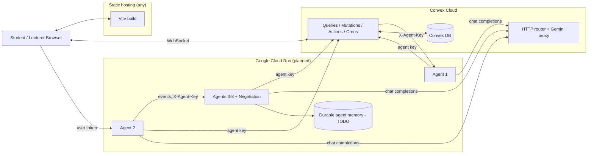

# Deployment Architecture

Target topology. The frontend and Convex parts are standard; the Cloud Run part is prepared
(Dockerfiles, Cloud Build configs) but **not yet deployed or verified**. See FUTURE_ACTIONS.

