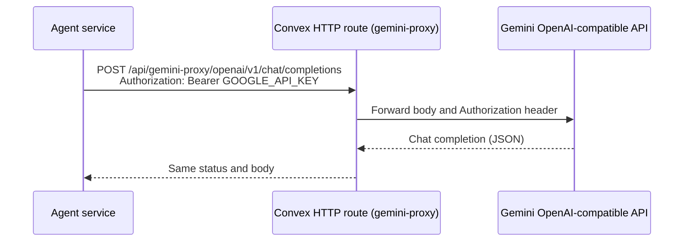

# API Sequence (Gemini proxy for agents)

The Convex route `/api/gemini-proxy/openai/v1/chat/completions` (`convex/geminiProxy.ts`) is a
plain pass-through. It does **not** apply rate limits or cost governance; the limits apply to the
student tutor inside Convex: the per-student help limit (`convex/application/aiService.ts`) and the flagged, off-by-default org limit and cost governance.

